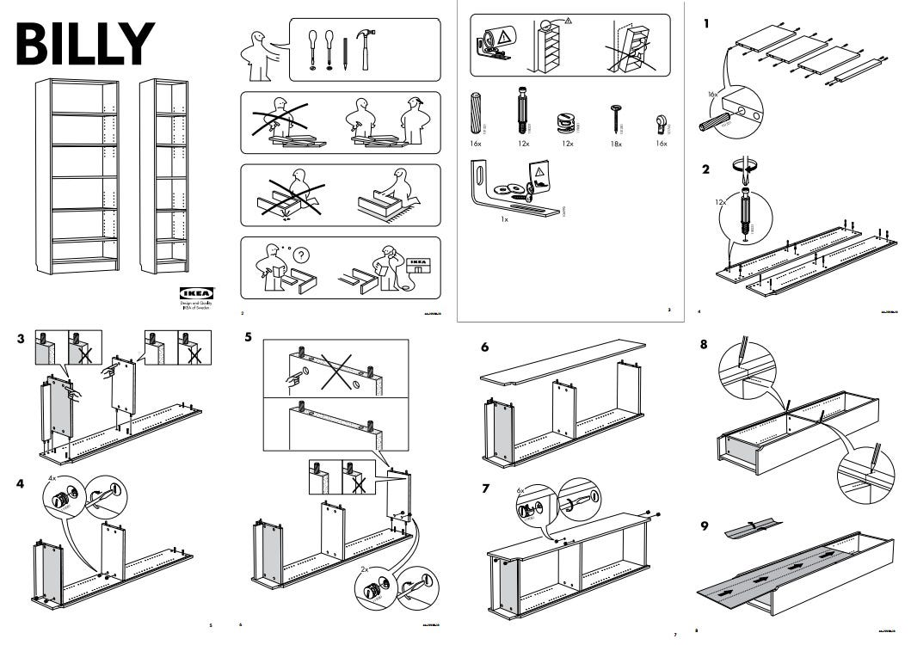

#  {.plain}
\center
\vspace{3mm}
```{r, echo = FALSE, out.width = "20%"}
knitr::include_graphics("0-Abbildungen/pfm-0-otto.png")
```

\vspace{4mm}

\Large
\resizebox{\linewidth}{!}{Einführung in die Forschungsmethoden der Psychologie}
\vspace{1mm}

\normalsize
BSc Philosophie-Neurowissenschaften-Kognition WiSe 2026/27

BSc Psychologie WiSe 2026/27

\large
\vspace{6mm}
Prof. Dr. Dirk Ostwald

#  {.plain}

\vfill
\center
\Huge
\textcolor{red}{Aufnahme läuft!}
\vfill

#  {.plain}

```{=latex}
\vfill
\begin{center}
\huge
(0) Formalia
\end{center}
\vfill
```

# Formalia 
\vfill
\large
$\,$ Prof. Dr. Dirk Ostwald (dirk.ostwald@ovgu.de)
\vspace{2mm}

\normalsize
\renewcommand{\arraystretch}{1.3}
\begin{tabular}{ll}
Seit 2021 	& W2-Professur Methodenlehre  				                        \\
2014 - 2020 & W1-Professur Freie Universität Berlin 	                        \\
2010 - 2014 & Postdoc BCCN \& MPIB Berlin				                        \\
2007 - 2010 & PhD Psychologie Birmingham				                        \\
2004 - 2006 & MSc Neurowissenschaften Tübingen			                        \\
2005 - 2012 & BSc Mathematik Hagen						                        \\
2000 - 2003 & BSc Medizin Hamburg						                        \\
\end{tabular}
\vspace{2mm}

\large
\begin{tabular}{ll}
Forschung 	    & Komputationale kognitive Neurowissenschaften	\\
Lehre 		      & Datenwissenschaft
\end{tabular}
\vfill

# Formalia
\small

BSc Psychologie

* Vorkurs: Mathematische Grundlagen
* A2 Einführung in die Forschungsmethoden der Psychologie
* B1 Statistik I (Wahrscheinlichkeitstheorie und frequentistische Inferenz)
* B2 Statistik II (Das allgemeine lineare Modell)
* C Einführung in empirisch-wissenschaftliches Arbeiten (Programmierung)
* E1 Grundlagen der Testtheorie (Fragebogendatenanalyse)

MSc Klinische Psychologie und Psychotherapie

* A1 Vertiefung allgemeiner Forschungsmethoden (Multivariate Verfahren)
* A2 Vertiefung allgemeiner Forschungsmethoden (Interventionsforschung)
* B2 Testtheorie und Testkonstruktion (Psychometrische Diagnostik)

MSc Psychologie und MSc Umweltpsychologie/Mensch-Technik-Interaktion

* Vorkurs: Programmieren für Psychologie
* A1 Multivariate Verfahren
* A3 Computergestützte Erhebung, Modellierung und Datenanalyse


# Formalia 
\vspace{1mm}
Modul A2. Einführung in die Forschungsmethoden der Psychologie

\small
\center
\footnotesize
\renewcommand{\arraystretch}{1.1}
\begin{tabular}{lll}
Datum        & Einheit                       & Thema				                                \\\hline
16.10.2026   & Formalia                      & (0) Formalia                                 \\
23.10.2026   & Wissenschaft                  & (1) Naturwissenschaft                        \\
30.10.2026   & Wissenschaft                  & (2) Psychologische Forschung                 \\
06.11.2026   & Wissenschaft                  & (3) Psychologische Daten                     \\
13.11.2026   & Wissenschaftsphilosophie      & (4) Realismus                                \\
20.11.2026   & Wissenschaftsphilosophie      & (5) Operationalismus                         \\
27.11.2026   & Wissenschaftsphilosophie      & (6) Repräsentalismus                         \\
04.12.2026   & Wissenschaftsphilosophie      & (7) Validität                                \\
11.12.2026   & Wissenschaftsphilosophie      & (8) Modellbasierter Realismus                \\
18.12.2026   & Studiendesign                 & (9) Grundlagen des Studiendesigns            \\
             & \textcolor{black!50}{Weihnachtspause}                    \\
08.01.2027   & Studiendesign                 & (10) Randomisierte Studiendesigns            \\
15.01.2027   & Studiendesign                 & (11) Nichtrandomisierte Studiendesigns        \\
22.01.2027   & Studiendesign                 & (12) Epidemiologische Forschung              \\
29.01.2027   & Studiendesign                 & (13) Qualitative Forschung                   \\\hline
März 2027    & Klausurtermin                 &                                \\
September 2027    & Klausurwiederholungstermin    &
\end{tabular}

# Formalia
Modul A2. Einführung in die Forschungsmethoden der Psychologie
\setstretch{3}

* Freitag 07.00 - 09.00 Uhr in Raum [G03-315](https://lsf.ovgu.de/qislsf/rds?state=verpublish&status=init&vmfile=no&moduleCall=webInfo&publishConfFile=webInfoRaum&publishSubDir=raum&keep=y&raum.rgid=34)  
* Kursmaterialien (Folien und Videos) auf der [Kurswebseite](https://www.ipsy.ovgu.de/Institut/Abteilungen+des+Institutes/Methodenlehre/Lehre/Wintersemester+2027/Einf%C3%BChrung+in+die+Forschungsmethoden+der+Psychologie.html)
* Ankündigungen und weiterführende Literatur auf der [Moodleseite](https://elearning.ovgu.de/course/view.php?id=22165)
* Formales Basiswissen vermittelt der Vorkurs [Mathematische Grundlagen](https://www.ipsy.ovgu.de/Institut/Abteilungen+des+Institutes/Methodenlehre/Lehre/Wintersemester+2027/Mathematische+Grundlagen.html)
* Der Kurs ist im Wesentlichen identisch zu seiner [vorherigen Iteration](https://www.ipsy.ovgu.de/Institut/Abteilungen+des+Institutes/Methodenlehre/Lehre/Wintersemester+2026/Einf%C3%BChrung+in+die+Forschungsmethoden+der+Psychologie.html)

# Formalia
Literaturempfehlung
\vspace{3mm}
\center
```{r, echo = FALSE, out.width = "40%"}
knitr::include_graphics("0-Abbildungen/pfm-0-literatur.pdf")
```


# Formalia
Modul A2. Einführung in die Forschungsmethoden der Psychologie
\setstretch{2}

* Vorlesungsfolien inklusive Selbstkontrollfragen sind klausurrelevant
* Selbstkontrollfragen fokussieren den Kursinhalt 
* Selbstkontrollfragen sind Grundlage für Prüfungsfragen
* Benotete digitale Multiple Choice Klausur (30 Fragen) im Universitätstestzentrum 
* "Gemeinsame Klausur" mit Modul A1. Einführung in die Psychologie 
* Klausurwiederholungstermin im September 2027
* Altklausuren auf den Kurswebseiten vorheriger Iterationen
* [Altklausur - Was wissen Sie schon?](https://elearning.ovgu.de/mod/quiz/view.php?id=696480)


# Formalia

```{r, eval = F}
library(readxl)    
yrs         = c(2025, 2026)
for(year in yrs){
  pdf(
  file        = file.path("0-Abbildungen", sprintf("pfm-0-pre-post-%s.pdf", substr(year, 3, 4))),
  width       = 8,
  height      = 4)
  par(
  family      = "serif",
  mfcol       = c(1,2),
  pty         = "m",
  bty         = "l",
  lwd         = 1,
  las         = 1,
  xaxs        = "i",
  yaxs        = "i",
  font.main   = 1,
  cex         = 1,
  cex.main    = 1)
  tags        =  c("Pre", "Post")

  # Iterationen
  for (tag in tags){                                                           
    
    # Datei zusammensetzen und einlesen
    fname     = file.path("0-Daten", paste0("Klausur-", year, "-", tag, ".xlsx"))
    D         = as.data.frame(read_excel(fname))
    
    # Spalte auswählen und NAs ausschließen
    x         = D$Bewertung
    x         = x[!is.na(x)]
    n         = length(x)
    
    # Histogramm zeichnen
    hist(
    x,
    breaks    = seq(min(x), max(x), 1),   # Klassenbreite = 1 Punkt
    col       = "gray",
    border    = "white",
    xlab      = "Punkte",
    ylab      = "Anzahl",
    xlim      = c(0,30), 
    ylim      = c(0,25), 
    main      = sprintf("Klausurpunkte %s-Kursteilnahme (n = %.0f)", tag, n))
  }
  dev.off()
}
```

Kurseffekt (Pre/Post) 2025

```{r, echo = FALSE, out.width = "100%"}
knitr::include_graphics("0-Abbildungen/pfm-0-pre-post-25.pdf")
```

# Formalia

Kurseffekt (Pre/Post) 2026

```{r, echo = FALSE, out.width = "100%"}
knitr::include_graphics("0-Abbildungen/pfm-0-pre-post-26.pdf")
```


# Formalia
\vspace{1mm}
\small
\center
Evaluation Einführung in die Psychologischen Forschungsmethoden WiSe 2024/25 (n = 29)
\center
\footnotesize
$\bullet$      Stimme voll und ganz zu       $\,$
$\bullet$ Stimme zu                     $\,$
$\bullet$     Neutral                       $\,$
$\bullet$     Stimme nicht zu               $\,$
$\bullet$        Stimme überhaupt nicht zu     $\,$
$\Box$                            k.A.
\vspace{1mm}

```{r, echo = FALSE, out.width = "90%"}
knitr::include_graphics("0-Abbildungen/pfm-0-evaluation-pfm-25.pdf")
```

Erhebungsdatum 26.03.2025

\normalsize
[Zentrale Evaluation WiSe 2026/27](https://www.ipsy.ovgu.de/ipsy_media/Methodenlehre/Wintersemester+2026/Einf%C3%BChrung+in+die+Forschungsmethoden+der+Psychologie/Forschungsmethoden_260325_Musterl%C3%B6sung-p-14300.pdf)

# Formalia
\vspace{2mm}
Zum Wesen dieser Veranstaltung
\vspace{2mm}
\center
```{r, echo = FALSE, out.width = "75%"}

```

# Formalia
\Huge
\vfill
\center
Q \& A
\vfill


