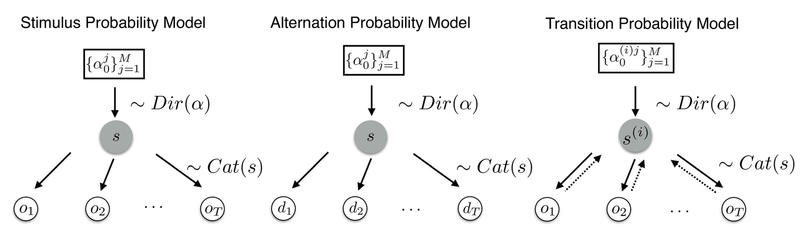
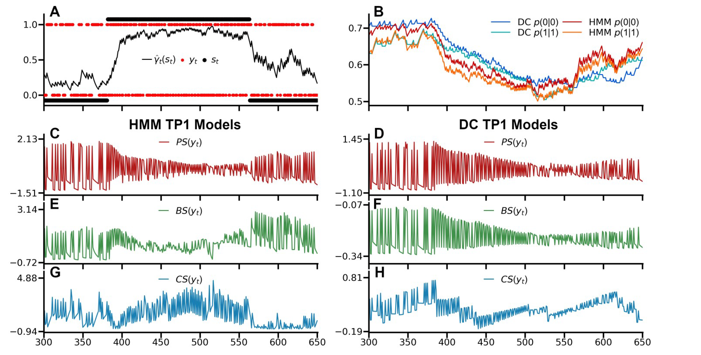

#  {.plain}
\center
\vspace{3mm}
```{r, echo = FALSE, out.width = "20%"}

```

\vspace{4mm}

\Large
\resizebox{\linewidth}{!}{Einführung in die Forschungsmethoden der Psychologie}
\vspace{1mm}

\normalsize
BSc Philosophie-Neurowissenschaften-Künstliche Intelligenz WiSe 2026/27

BSc Psychologie WiSe 2026/27

\large
\vspace{6mm}
Prof. Dr. Dirk Ostwald

#  {.plain}

\vfill
\center
\huge
\textcolor{black}{(2) Psychologische Forschung}
\vfill

#
\vfill
\setstretch{2.7}
\large

Formen psychologischer Forschung

Beispiele psychologischer Grundlagenforschung

Beispiele psychologischer Anwendungsforschung

Psychologische Anwendungsforschung durch BigTech

Selbstkontrollfragen
\vfill

#
\vfill
\setstretch{2.7}
\large

**Formen psychologischer Forschung**

Beispiele psychologischer Grundlagenforschung

Beispiele psychologischer Anwendungsforschung

Psychologische Anwendungsforschung durch BigTech

Selbstkontrollfragen
\vfill

# Formen psychologischer Forschung

\vspace{2mm}
```{r, echo = FALSE, out.width = "100%", fig.align = "center"}
knitr::include_graphics("2-Abbildungen/pfm-2-psychologie.pdf")
```


# Formen psychologischer Forschung
\large
Definitionsversuche und Ähnlichkeiten
\normalsize

Grundlagenforschung
\small

* Verstehen der mechanistischen Zusammenhänge eines Gegenstandbereichs.
* Verstehen, wie und warum etwas funktioniert, wie es funktioniert.
* Wissensbasierte intuitive Generation neuer mechanistischer Ideen.
* Quantitative Überprüfung der generierten Ideen im empirischen Kontext.
* Kommunikation und rationale Diskussion der Ideen und ihres empirischen
  Supports.

\normalsize
Anwendungsforschung
\small

* Verstehen, welche Form von Intervention ein gewünschtes Ergebnis hervorbringt.
* Verstehen, wie etwas verändert werden kann ohne notwendig, zu verstehen, wie
  es funktioniert.
* Wissensbasierte intuitive Generation neuer Interventionsformen.
* Quantitative Überprüfung von Interventionen im empirischen Kontext.
* Kommunikation und rationale Diskussion der Interventionen und ihres
  empirischen Supports.


# Formen psychologischer Forschung
\large
Praktische Aspekte und Unterschiede
\normalsize

Grundlagenforschung
\small

* Themenwahl meist frei durch die Forschenden.
* Ziel ist wissenschaftlicher Erkenntnisgewinn.
* Aktueller Forschungsstand und größtmögliche wissenschaftliche Strenge.
* Bewertung durch Fachkolleg:innen primär nach wissenschaftlichen Kriterien.
* Publikationen und Zitationen, indirekter Praxisnutzen durch Anwendungen.

\normalsize
Anwendungsforschung
\small

* Themen meist durch Auftraggeber:innen vorgegeben.
* Ziel sind wissenschaftliche Befunde mit praktischem Nutzen.
* Zeit, Budget und Praxisbedingungen begrenzen die wissenschaftliche Strenge.
* Bewertung durch Auftraggeber:innen primär nach praktischem Nutzen.
* Grundlage für Praxisentscheidungen, teils Publikationen und Erkenntnisgewinn.

\flushright
\footnotesize 

Nach @doering2023, Kapitel 1, Tabelle 1.3.

Vgl. @freeman1984 [S. 572] und @neuman2011 [S. 23].

# Formen psychologischer Forschung
\large
\setstretch{1.5}
Psychologische Studien
\normalsize

Theoretische Studien

* Präsentation und Bewertung des Forschungsstands zu einem Gegenstand (Review)
* Formalisierung und Simulation quantitativer Theorien

Methodische Studien

* Vergleich und Weiterentwicklung von Forschungsmethoden
* Simulation und Anwendung datenanalytischer Verfahren

Empirische Studien

* Behandlung inhaltlicher Forschungsthemen mithilfe empirischer Methoden
* Originalstudien, Replikationsstudien, Metaanalysen

\flushright
\footnotesize
Vgl. @doering2023, Kapitel 7

# Formen psychologischer Forschung
\setstretch{1.5}
\large
Empirische Studien
\normalsize

Deskriptive Studien

* Charakterisierung einer Population anhand repräsentativer Stichproben
* Meist großer Stichprobenumfang und deskriptiv-statistisches Vorgehen

Explorative Studien 

* Erkundung bisher wenig untersuchter Gegenstandsbereiche
* Meist kleiner Stichprobenumfang und wenig standardisiertes Vorgehen

Explanative Studien

* Konfirmatorische Überprüfung aus der Theorie hergeleiteter Hypothesen
* Meist mittlerer Stichprobenumfang und eher inferenzstatistisches Vorgehen

\flushright
\footnotesize
Vgl. @doering2023, Kapitel 7


# Formen psychologischer Forschung

Gliederung zur Diskussion der folgenden Beispiele 
\setstretch{2.5}

* Gegenstand und Phänomen
* Experimentelle Simulation aka Studiendesign
* Theorie
* Datenvorhersage aka Hypothese
* Datenanalyse und Ergebnis

#
\vfill
\setstretch{2.7}
\large

Formen psychologischer Forschung

**Beispiele psychologischer Grundlagenforschung**

Beispiele psychologischer Anwendungsforschung

Psychologische Anwendungsforschung durch BigTech

Selbstkontrollfragen
\vfill

# Beispiele psychologischer Grundlagenforschung
\normalsize
\vspace{2mm}
Beispiel zum Erklären und Vorhersagen menschlichen Verhaltens
\vspace{2mm}


```{=latex}
\begin{center}
\includegraphics[height=58mm]{2-Abbildungen/pfm-2-abm-ueberblick.pdf}
\end{center}
```
\flushright
\footnotesize
@ostwald2026, @usee2026


# Beispiele psychologischer Grundlagenforschung
\vspace{2mm}
\normalsize
Gegenstandsbereich und Phänomen
\normalsize
\setstretch{1.8}

* Bei Angststörungen kann übermäßige Vermeidung den Alltag einschränken.
* Vermeidung verhindert korrigierende Erfahrungen und kann Ängste erhalten.
* Approach-avoidance conflict entsteht bei möglicher Belohnung und Bestrafung.
* Visuelles foraging macht die Suche unter solchen Konflikten untersuchbar.
* Das Marginal-Value-Theorem beschreibt sequenzielles Verhalten beim foraging.
* Maßstab ist die durchschnittlich verfügbare Ertragsrate der Umgebung.
* Daran orientierte Agentenmodelle beschreiben das Beenden der konflikthaften Suche.

\flushright
\footnotesize
@usee2026


# Beispiele psychologischer Grundlagenforschung
\vspace{1mm}
\normalsize
Experimentelle Simulation
\vfill

```{=latex}
\begin{center}
\includegraphics[width=0.9\linewidth,height=53.1mm,keepaspectratio]{2-Abbildungen/pfm-2-usee-experiment-ab.pdf}
\end{center}
```
\vfill

\flushright
\footnotesize
@usee2026

# Beispiele psychologischer Grundlagenforschung
\vspace{1mm}
\normalsize
Experimentelle Simulation
\vfill

```{=latex}
\begin{center}
\includegraphics[width=0.9\linewidth,height=53.1mm,keepaspectratio]{2-Abbildungen/pfm-2-usee-experiment-c.pdf}
\end{center}
```
\vfill

\flushright
\footnotesize
@usee2026

# Beispiele psychologischer Grundlagenforschung
\vspace{1mm}
\normalsize
Experimentelle Simulation
\vfill

```{=latex}
\begin{center}
\includegraphics[width=0.81\linewidth,height=47.79mm,keepaspectratio]{2-Abbildungen/pfm-2-usee-unique-clicks.pdf}
\end{center}
```

\flushright
\small
Online Studie ($n = 87$)

\vspace{-1mm}

\footnotesize
@usee2026

# Beispiele psychologischer Grundlagenforschung
\normalsize
Theorie
\small
\setlength{\abovedisplayskip}{2pt}
\setlength{\belowdisplayskip}{3pt}
\setlength{\abovedisplayshortskip}{2pt}
\setlength{\belowdisplayshortskip}{3pt}

Current value (A8)
\begin{equation}
\notag
v_8(s,t,c) = \beta_{0,s} + \beta_1 r_s + \beta_2 p_s
- \beta_1 n_r(s,t,c) + \beta_2 n_p(s,t,c) + \beta_4 t_z
\mbox{ mit } \beta_1 > 0,\quad \beta_2 < 0
\end{equation}

Reference value
\begin{equation}
\notag
\bar v(s) = \frac{1}{|S|-1}
\sum_{s' \in S\setminus\{s\}}\left(\beta_1 r_{s'}+\beta_2 p_{s'}\right)
\end{equation}

Conditional stopping probability
\begin{equation}
\notag
\pi_i(s,t,c) = \frac{1}{1+\exp\left(v_i(s,t,c)-\bar v(s)\right)},
\quad c<16,\quad \pi_i(s,t,16)=1
\end{equation}

Distribution of latent decisions
\begin{equation}
\notag
p_i(a_t=c\mid s_t) = \pi_i(s_t,t,c)
\prod_{k=1}^{c-1}\left(1-\pi_i(s_t,t,k)\right),
\quad c=1,\ldots,16
\end{equation}

\footnotesize
$i\in\{7,8\}$, $n_r,n_p$: bisher gefundene Belohnungen bzw. Bestrafungen,
$t_z$: standardisierter Trial-Index.

\flushright
\footnotesize
@usee2026

# Beispiele psychologischer Grundlagenforschung
\vspace{1mm}
\normalsize
Datenvorhersage
\vfill

```{=latex}
\begin{center}
\includegraphics[width=\linewidth,height=60mm,keepaspectratio]{2-Abbildungen/pfm-2-usee-datenvorhersage.pdf}
\end{center}
```
\vfill

\flushright
\footnotesize
@usee2026

# Beispiele psychologischer Grundlagenforschung
\vspace{1mm}
\normalsize
Ergebnis
\vfill

```{=latex}
\begin{center}
\includegraphics[width=0.9\linewidth]{2-Abbildungen/pfm-2-usee-ergebnis.pdf}
\end{center}
```

\begingroup
\centering
\footnotesize
\setstretch{1.1}

BIC: Bayesian information criterion [@schwarz1978].

PEP: Protected exceedance probability [@rigoux2014].

\par
\endgroup
\small
\setstretch{1.5}

* Kumulativer BIC: A8 vor A7, beide deutlich vor den GLM-Agenten A0--A6.
* Individuelle Modellsiege: A7 bei 27 Personen, A8 bei 21 Personen.
* PEP: A7 und A8 nahezu gleichauf (0.51 bzw. 0.49), A0--A6 nahe null.


\vfill

\flushright
\footnotesize
@usee2026

# Beispiele psychologischer Grundlagenforschung
\vspace{1mm}
\normalsize
Beispiel zur Entwicklung mechanistischer neuropsychologischer Modelle
\vspace{1mm}

\normalsize
Gegenstandsbereich und Phänomen

```{=latex}
\begin{center}
\includegraphics[width=\linewidth,height=55mm,keepaspectratio]{2-Abbildungen/pfm-2-bayesian-brain-hypothesis-ohne-links.pdf}
\end{center}
```

\flushright
\footnotesize
@helmholtz1867, @friston2005, @ostwald2012, @gijsen2021

# Beispiele psychologischer Grundlagenforschung
\normalsize
Experimentelle Simulation
\vfill
```{r, echo = FALSE, out.width = "70%", fig.align = "center"}
knitr::include_graphics("2-Abbildungen/pfm-2-somatosensation-eeg.pdf")
```
\vfill

\flushright
\footnotesize
@ostwald2012, @gijsen2021

# Beispiele psychologischer Grundlagenforschung
\normalsize
Experimentelle Simulation
\vfill
```{r, echo = FALSE, out.width = "70%", fig.align = "center"}
knitr::include_graphics("2-Abbildungen/pfm-2-gijsen-experimentelle-simulation-font.pdf")
```
\vfill
\flushright
\footnotesize
@ostwald2012, @gijsen2021

# Beispiele psychologischer Grundlagenforschung
\normalsize
\vspace{2mm}
Theorie
```{r, echo = FALSE, out.width = "60%", fig.align = "center"}

```
Datenvorhersage
```{r, echo = FALSE, out.width = "60%", fig.align = "center"}

```

\flushright
\footnotesize
@gijsen2021

# Beispiele psychologischer Grundlagenforschung
\normalsize
Ergebnis
\vspace{2mm}

```{r, echo = FALSE, out.width = "90%", fig.align = "center"}
knitr::include_graphics("2-Abbildungen/pfm-2-gijsen-datenanalyse.pdf")
```
\footnotesize
\setstretch{1.5}

* Das nicht-hierarchische Dirichlet-Categorical-Modell erklärt die EEG-Daten
  am besten.
* Bayesian surprise [@itti2009]: um 140 ms in S1, zeitlich wie bei @ostwald2012.
* Confidence-corrected surprise [@faraji2018]: ab etwa 70 ms in S2.
\flushright
\footnotesize
@gijsen2021

#
\vfill
\setstretch{2.7}
\large

Formen psychologischer Forschung

Beispiele psychologischer Grundlagenforschung

**Beispiele psychologischer Anwendungsforschung**

Psychologische Anwendungsforschung durch BigTech

Selbstkontrollfragen
\vfill

# Beispiele psychologischer Anwendungsforschung

\normalsize
Gegenstandsbereich und Phänomen

\small
Welche Therapieform ist bei Depression wirksamer?

\begin{center}
\makebox[0.39\linewidth]{Online (schriftlich)}
\makebox[0.39\linewidth]{Face-to-face}
\end{center}

\vspace{-1mm}

```{r, echo = FALSE, out.width = "80%", fig.align = "center"}

```

\flushright
\footnotesize
@wagner2014

# Beispiele psychologischer Anwendungsforschung
\normalsize
Gegenstandsbereich und Phänomen

\small
Becks Depressions-Inventar (BDI-II) zur Depressionsdiagnostik

```{r, echo = FALSE, out.width = "100%", fig.align = "center"}
knitr::include_graphics("2-Abbildungen/pfm-2-bdi.pdf")
```

\flushright
\footnotesize
@wagner2014

# Beispiele psychologischer Anwendungsforschung
\vspace{2mm}
\normalsize
Experimentelle Simulation
\setstretch{1.8}

\vspace{-1mm}
\small

* Zufällige Zuordnung mittelschwer Depressionserkrankter zu Online vs.
  Face-To-Face
* Im Wesentlichen identisches Behandlungsprotokoll in beiden Gruppen
  * \small 8 Wochen Kognitive Verhaltenstherapie nach @hautzinger2021.
  * Im Online Kontext nur schriftliches Feedback.

\normalsize
Theorie
\vspace{-1mm}
\small

* Es gibt Evidenz, dass internetbasierte Interventionen effektiv sind.
* Es gibt Evidenz, dass Therapeuten-geleitete effektiver als selbstgeleitete
  Interventionen sind.

\normalsize
Datenvorhersage
\vspace{-1mm}
\small

* Die BDI-Differenzen zwischen Prä- und Posttherapie unterscheiden sich nicht.

\flushright
\footnotesize
@wagner2014

# Beispiele psychologischer Anwendungsforschung
\vspace{2mm}
\normalsize
Datenanalyse

```{r, echo = FALSE, out.width = "53%", fig.align = "center"}
knitr::include_graphics("2-Abbildungen/pfm-2-wagner-ergebnis.pdf")
```
\footnotesize
\setstretch{1.5}

* Beide Therapieformen reduzieren die Depressionssymptome deutlich
  (online: $d = 1.27$, Face-to-face: $d = 1.37$).
* Direkt nach der Therapie unterscheiden sich die BDI-II-Werte nicht
  signifikant zwischen den Gruppen.
* Nach drei Monaten: online stabil, Face-to-face wieder höhere BDI-II-Werte
  (Gruppenunterschied: $p = .09$).

\flushright
\footnotesize
@wagner2014


#
\vfill
\setstretch{2.7}
\large

Formen psychologischer Forschung

Beispiele psychologischer Grundlagenforschung

Beispiele psychologischer Anwendungsforschung

**Psychologische Anwendungsforschung durch BigTech**

Selbstkontrollfragen
\vfill


# Psychologische Anwendungsforschung durch BigTech
\vspace{1mm}
\normalsize
Persönlichkeitspsychologie und Partnermatching bei Parship
\vspace{2mm}
```{r, echo = FALSE, out.width = "90%", fig.align = "center"}
knitr::include_graphics("2-Abbildungen/pfm-2-bigtech-parship-collage.pdf")
```
\footnotesize
\setstretch{1.4}

* Ein Fragebogen erfasst partnerschaftsbezogene Eigenschaften, Wünsche und
  Verhaltensweisen.
* Der Algorithmus vergleicht Profile anhand von Gemeinsamkeiten und
  Unterschieden.
* Matching-Punkte sollen laut Anbieter die partnerschaftliche Passung
  vorhersagen.
* Alter, Entfernung und weitere Suchfilter ergänzen die Partnervorschläge.

\flushright
\footnotesize

[\textcolor{darkblue}{Das Parship-Prinzip (2026)}](https://www.parship.de/tour/parship-prinzip/)

# Psychologische Anwendungsforschung durch BigTech
\vspace{1mm}
\normalsize
Kaufentscheidungsverhalten und Recommender Systems
```{r, echo = FALSE, out.width = "100%", fig.align = "center"}
knitr::include_graphics("2-Abbildungen/pfm-2-bigtech-recommender-collage.pdf")
```
\footnotesize
\setstretch{1.4}

* Empfehlungssysteme sagen individuelle Präferenzen für Produkte und Inhalte
  vorher.
* Klicks, Käufe und Bewertungen liefern Verhaltensdaten für personalisierte
  Empfehlungen.
* Collaborative Filtering nutzt ähnliche Nutzende, Content-based Filtering
  ähnliche Inhalte.
* Die Vorhersagegüte wird an neuen Daten geprüft, der praktische Nutzen
  etwa durch A/B-Tests.

\flushright
\footnotesize

@aggarwal2016

# Psychologische Anwendungsforschung durch BigTech
\vspace{1mm}
\normalsize
Psychische Gesundheit und Gesprächsverhalten bei ChatGPT

\vspace{2mm}

```{r, echo = FALSE, out.width = "48%", fig.align = "center"}
knitr::include_graphics("2-Abbildungen/pfm-2-chatgpt-affective-illustration.pdf")
```
\vspace{2mm}

\footnotesize
\setstretch{1.4}

* OpenAI untersucht Gesprächssignale für Psychose, Manie und andere schwere
  psychische Symptome.
* Geschätzte Psychose-/Maniesignale: 0.07\% der wöchentlich aktiven Nutzenden
  und 0.01\% der Nachrichten.
* GPT-5-Update: laut OpenAI 65\% weniger unerwünschte Antworten in realen
  Gesprächen.
* Expertenevaluation: 39\% weniger unerwünschte Antworten als GPT-4o
  ($n = 677$).
* Automatisierte Tests ($n > 1\,000$): 92\% statt 27\% der Antworten entsprechen
  OpenAIs Vorgaben.

\flushright
\footnotesize

[\textcolor{darkblue}{OpenAI.com (2025)}](https://openai.com/index/strengthening-chatgpt-responses-in-sensitive-conversations/)

# Psychologische Anwendungsforschung durch BigTech
\vspace{1mm}
\normalsize
Selbstkonzeptforschung durch Meta
\vspace{1mm}
```{r, echo = FALSE, out.width = "55%", fig.align = "center"}
knitr::include_graphics("2-Abbildungen/pfm-2-bigtech-facebook-collage.pdf")
```
\footnotesize
\setstretch{1.4}

* Facebook erforscht soziale Vergleiche auf Instagram und das Körperbild
  jugendlicher Nutzerinnen und Nutzer.
* Negative soziale Vergleiche berichten 66\% der befragten Mädchen und 40\%
  der Jungen.
* 32\% der Mädchen mit negativem Körpergefühl berichten, dass Instagram
  dieses Gefühl verstärkt.
* Die explorativen Selbstberichte erlauben keine kausalen Aussagen zur
  Wirkung von Instagram.

\flushright
\footnotesize

[\textcolor{darkblue}{Facebook (2020)}](https://s.wsj.net/public/resources/documents/teen-girls-body-image-and-social-comparison-on-instagram.pdf),
[\textcolor{darkblue}{Wall Street Journal (2021)}](https://www.wsj.com/articles/the-facebook-files-11631713039),
[\textcolor{darkblue}{Sony Pictures (2026)}](https://www.sonypictures.com/movies/thesocialreckoning)

#
\vfill
\setstretch{2.7}
\large

Formen psychologischer Forschung

Beispiele psychologischer Grundlagenforschung

Beispiele psychologischer Anwendungsforschung

Psychologische Anwendungsforschung durch BigTech

**Selbstkontrollfragen**
\vfill

# Selbstkontrollfragen
\footnotesize
\setstretch{4}
1. Definieren Sie den Begriff Psychologie.
1. Nennen Sie vier Aspekte psychologischer Wissenschaft.
1. Erläutern Sie den Begriff der psychologischen Grundlagenforschung.
1. Erläutern Sie den Begriff der psychologischen Anwendungsforschung.
1. Erläutern Sie die Begriffe der theoretischen, methodischen und empirischen
  Studien.
1. Erläutern Sie die Begriffe der explorativen, deskriptiven und explanativen
  empirischen Studien.

# Referenzen {.allowframebreaks}
\footnotesize
\setstretch{1.2}
