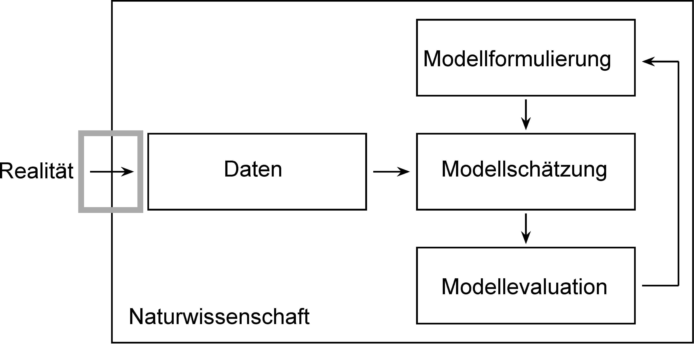
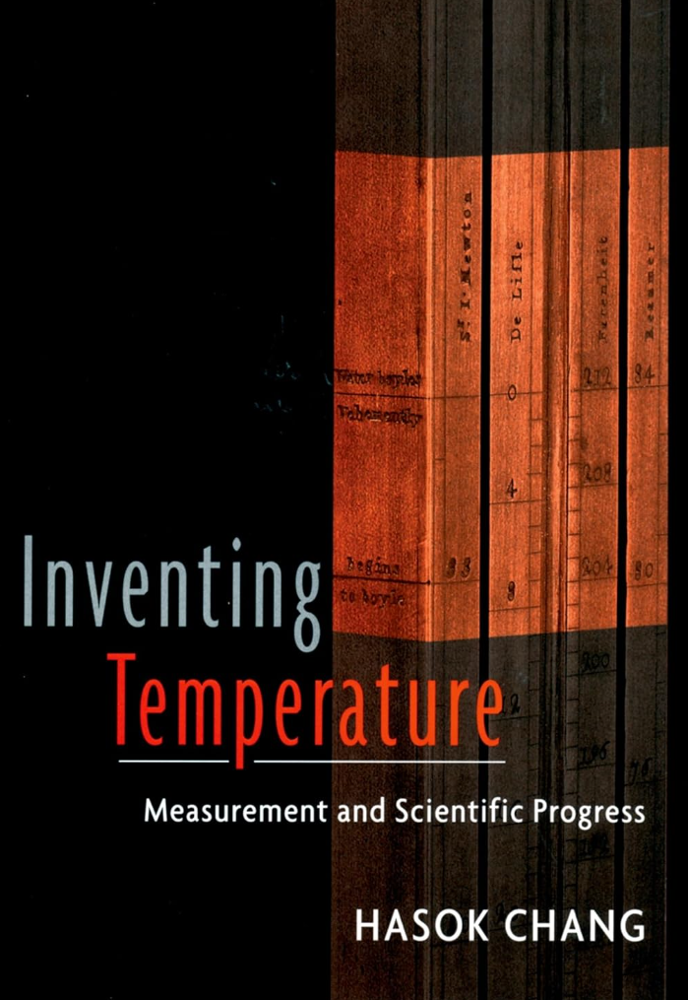
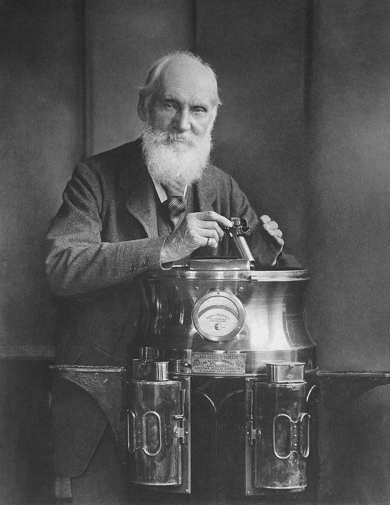
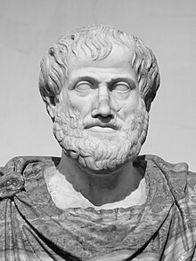
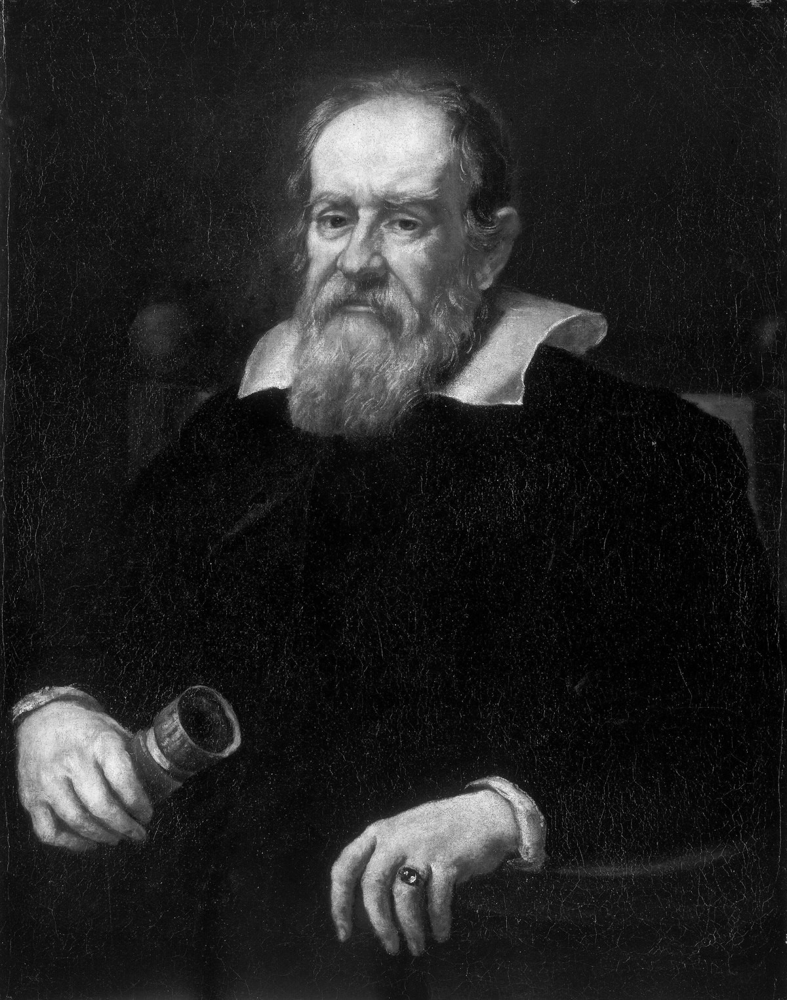
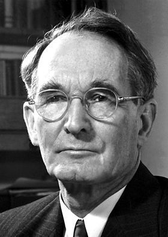
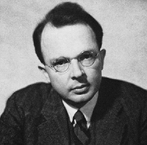

#  {.plain}
\center
\vspace{3mm}
```{r, echo = FALSE, out.width = "20%"}
knitr::include_graphics("4-Abbildungen/pfm-4-otto.png")
```

\vspace{4mm}

\Large
\resizebox{\linewidth}{!}{Einführung in die Forschungsmethoden der Psychologie}
\vspace{1mm}

\normalsize
BSc Philosophie-Neurowissenschaften-Künstliche Intelligenz WiSe 2026/27

BSc Psychologie WiSe 2026/27

\large
\vspace{6mm}
Prof. Dr. Dirk Ostwald

#  {.plain}
\vfill
\center
\huge
\textcolor{black}{(4) Messen und Quantifizieren}
\vfill

#
\vfill
\large
\setstretch{3}
Messen und Quantifizieren

Naiver Realismus

Operationalismus

Selbstkontrollfragen 
\vfill

#
\vfill
\large
\setstretch{3}
**Messen und Quantifizieren** 

Naiver Realismus

Operationalismus

Selbstkontrollfragen 
\vfill

# Messen und Quantifizieren
\vfill
\begin{center}
\includegraphics[width=0.98\linewidth,height=54mm,keepaspectratio]{4-Abbildungen/pfm-4-messen-steinzeit-aquarell.png}

\vspace{2mm}
{\fontsize{8}{10}\selectfont
Symbolische quantitative Repräsentation\par}
\end{center}
\vfill

# Messen und Quantifizieren
\vfill
\begin{center}
\begin{tikzpicture}
\node[inner sep=0] (collage) {\includegraphics[width=0.98\linewidth,height=54mm,keepaspectratio]{4-Abbildungen/pfm-4-oekonomisches-messen-aquarell.png}};

\node[anchor=south west,align=left,text width=39mm,inner sep=1mm,fill=white,font=\setstretch{1.0}\fontsize{5.5}{6.8}\selectfont] at ([yshift=3mm]collage.south) {Leviticus 19:35-36\\
Do not use dishonest standards when measuring length, weight or quantity.
Use honest scales and honest weights, an honest ephah and an honest hin.\\[1mm]
I am the LORD your God, who brought you out of Egypt.};

\end{tikzpicture}

\vspace{2mm}
{\fontsize{8}{10}\selectfont
Zahlen und Messen im ökonomischen Kontext seit alters her\par}
\end{center}
\vfill

# Messen und Quantifizieren
\vfill
\begin{center}
\includegraphics[width=0.98\linewidth,height=54mm,keepaspectratio]{4-Abbildungen/pfm-4-wissenschaftliche-revolution-aquarell.png}

\vspace{2mm}
{\fontsize{8}{10}\selectfont
Bedeutungsgewinn durch wissenschaftliche Revolution und Industrialisierung\par}
\end{center}
\vfill

# Messen und Quantifizieren
\vfill
\begin{center}
\includegraphics[width=0.98\linewidth,height=54mm,keepaspectratio]{4-Abbildungen/pfm-4-technisches-messen-heute-aquarell.png}

\vspace{2mm}
{\fontsize{8}{10}\selectfont
Zeitgenössische Messung physikalischer Phänomene\par}
\end{center}
\vfill

# Messen und Quantifizieren
\vfill
\begin{center}
\includegraphics[width=0.98\linewidth,height=54mm,keepaspectratio]{4-Abbildungen/pfm-4-messen-psychologie-heute-aquarell.png}

\vspace{2mm}
{\fontsize{8}{10}\selectfont
Zeitgenössische Messung psychobiologischer Phänomene\par}
\end{center}
\vfill

# Messen und Quantifizieren
\vfill
\large
Messen ist Datenerhebung...

\vspace{2mm}
\center
```{r, echo = FALSE, out.width = "80%"}

```
\vspace{2mm}
\flushright
... aber ist jede Datenerhebung Messen?

\small
Und was für eine Messtheorie steckt eigentlich hinter der modell-basierten Datenwissenschaft?

# Messen und Quantifizieren
\setstretch{1.6}

Messen und Quantifizieren werfen Fragen der Epistemologie und Ontologie auf

Epistemologie (Lehre von der Erkenntnis)

* Was ist Wissen?
* Wie erwerben wir Wissen?
* Was sind die Grenzen des Wissens?
* Wie beeinflussen Sprache und Konzepte unser Wissen?

Ontologie (Lehre vom Sein)

* Was bedeutet „Sein“?
* Was existiert?
* Gibt es Kausalität, und wenn ja, was ist sie?
* Was ist der Status von Raum und Zeit?


# Messen und Quantifizieren  
\vfill
Messen hat epistemische und soziale Autorität

* Messen gilt als effektive Methode zur Generation von Wissen
* Etwas zu messen wird generell als besser angesehen, als etwas nur zu behaupten

\vspace{4mm}

Messen ist eine sehr unklare Aktivität

* Was ist Messen überhaupt und wann handelt es sich um eine Messung, wann nicht?
* Müssen Dinge unabhängig von menschlicher Anschauung sein, um messbar zu sein?
* Kann alles gemessen werden, "physikalische" Eigenschaften genauso wie "psychologische" Eigenschaften, 
also die Länge eines Stabes ebenso wie die Intelligenz, oder die Temperatur eines Gegenstandes 
genauso wie Stärke einer Empfindung?

Für eine Einführung folgen wir 

* "Philosophical perspectives on measurement" in @mari2021
* "Measurement in Science" von @tal2020

Für einen aktuellen Diskurs, siehe auch @pedersen2025


# Messen und Quantifizieren
\vspace{1mm}
Messen ist eine sehr unklare Aktivität

\vspace{2mm}
\begingroup
\setstretch{1.0}
\fontsize{6}{6.5}\selectfont
\setlength{\tabcolsep}{4pt}
\renewcommand{\arraystretch}{1.0}
\setlength{\LTpre}{0pt}
\setlength{\LTpost}{0pt}
\setlength{\extrarowheight}{2pt}
\let\raggedright\RaggedRight

::: {tbl-colwidths="[34,66]"}

| Criterion | Exemplary definition/characterization |
|:----------------------------------|:------------------------------------------------------------------|
| *Is measurement characterized by the structure of the process?* | [Any] measurement system consists of several elements or blocks. It is possible to identify four types of element, although in a given system one type of element may be missing or may occur more than once. [@bentley2005] |
| *Or by the results it produces?* | Measurement is essentially a production process, the product being numbers. [@speitel1992] |
| *Does measurement imply comparison to a reference, possibly a unit?* | Measurements are executions of planned actions for a qualitative comparison of a measurement quantity with a unit. [@din1995] |
| *Or not?* | Measurement is the process of empirical, objective assignment of numbers to the attributes of objects and events of the real world, in such a way as to describe them. [@finkelstein1994] |
| *Are numbers required products of measurement?* | Measurement of magnitudes is, in its most general sense, any method by which a unique and reciprocal correspondence is established between all or some of the magnitudes of a kind and all or some of the numbers, integral, rational, or real, as the case may be. [@russell1903] |
| *Or not?* | The only decisive feature of all measurements is symbolic representation. Even numbers are in no way the only usable symbols. Measurement permits things (relative to the assumed measuring basis) to be presented conceptually, by means of symbols. [@weyl1949] |
| *Are experimental activities required to perform a measurement?* | Measurement is the set of empirical and informational operations performed by means of suitable devices interacting with the system under measurement with the purpose of assigning a value of a quantity assumed as parameter of the system. [@uni1984] (translated from Italian) |
| *Or not?* | Measurement is the assignment of numerals to objects or events according to rule, any rule. [@stevens1959] |

:::

\endgroup

\vspace{1mm}
\tiny
\flushright
Nach @mari2021, Tabelle 4.1, S. 74.

# Messen und Quantifizieren  
\vspace{3mm}
Eine wissenschaftshistorische Beispielstudie
\vspace{1mm}
```{r, echo = FALSE, out.width = "30%", fig.align = "center"}

```
\vspace{1mm}
\footnotesize

"Chang's book shows that many items of knowledge that we take for granted now are in fact spectacular achievements, obtained only after a great deal of innovative thinking, painstaking experiments, bold conjectures, and controversy. Lurking behind these achievements are some very important philosophical questions about how and when people accept the authority of science."

\flushright
@chang2007


# Messen und Quantifizieren {.columns}

:::: {.column width="40%"}
\center
\vspace{3mm}
{width=80%}

\footnotesize
William Thomson aka Lord Kelvin
::::

:::: {.column width="60%"}
\vspace{10mm}

"I often say that when you can measure what you are speaking about and express 
it in numbers you know something about it; but when you cannot measure it, when
you cannot express it in numbers, your knowledge of it is of a meagre and 
unsatisfactory kind; it may be the beginning of knowledge, but you have scarcely, 
in your thoughts, advanced to the stage of science, whatever that may be." (Thomson, 1891)
::::


#
\vfill
\large
\setstretch{3}
Einleitung

**Naiver Realismus**

Operationalismus

Selbstkontrollfragen 
\vfill

# Naiver Realismus
\vfill
\begin{center}
\includegraphics[width=0.98\linewidth,height=65mm,keepaspectratio]{4-Abbildungen/pfm-4-naiver-realismus-aquarell.png}
\end{center}
\vfill

# Naiver Realismus 
Grundannahmen
\setstretch{2.5}

* Die Welt existiert unabhängig von uns und unserem Verständnis von ihr.
* Unser Weltwissen ist direkt und ungefiltert von konzeptuell-sprachlichen Schemata.
* Jede Objekteigenschaft hat einen wahren Wert. 
* Ziel einer Messung ist es, den wahren Wert einer Objekteigenschaft festzustellen.
* Messen ist ein Transmissionsprozess, im Idealfall eine Identitätsabbildung.
* Objekte haben mathematische Struktur unabhängig von menschlicher Kognition. 


# Naiver Realismus {.columns}

:::: {.column width="40%"}

\vspace{5mm}
\center
{width=70%}

\footnotesize

Aristoteles (350 v. Chr.) 

*Metaphysik*
::::

:::: {.column width="60%"}
\footnotesize

"Unter diesen nun und noch vor ihnen haben die Pythagoreer, wie man sie nennt, 
sich mit dem Studium der Mathematik beschäftigt und zunächst diese gefördert; 
in dieser heimisch geworden, haben sie so dann die Prinzipien derselben zu 
Prinzipien des Seienden überhaupt machen zu dürfen geglaubt. Da nun unter den 
Prinzipien der Mathematik der Natur der Sache nach in erster Linie die Zahlen stehen, 
so glaubten sie in den Zahlen mancherlei Gleichnisse für das, was ist und was 
geschieht zu finden, und zwar hier eher als in Feuer, Erde oder Wasser. So 
bedeutete ihnen eine Zahl mit bestimmten Eigenschaften die Gerechtigkeit, eine 
andere Seele und Vernunft, wieder eine andere den rechten Augenblick, und so 
fand sich eigentlich für alles ein Gleichnis in einer Zahl. Da sie nun auch 
darauf aufmerksam wurden, dass die Verhältnisse und Gesetze der musikalischen 
Harmonie sich in Zahlen darstellen lassen, und da auch alle anderen Erscheinungen 
eine natürliche Verwandtschaft mit den Zahlen zeigten, die Zahlen aber das erste 
in der gesamten Natur sind, so kamen sie zu der Vorstellung, die Elemente der 
Zahlen seien die Elemente alles Seienden und das gesamte Weltall sei eine 
Harmonie und eine Zahl."
::::    

# Naiver Realismus {.columns}

:::: {.column width="40%"}
\vspace{8mm}

\center
{width=70%}
\footnotesize

Galilei (1623) 

*Der Prüfer mit der Goldwaage*
::::

:::: {.column width="60%"}
\small
\vspace{8mm}

"Die Philosophie ist in diesem großartigen Buch geschrieben, das vor unseren 
Augen immer offen steht (ich meine das Universum), das man aber nicht begreifen 
kann, wenn man nicht zuerst lernt, die Sprache zu verstehen und die Buchstaben 
zu erkennen, in denen es geschrieben ist. Es ist in mathematischer Sprache 
geschrieben, und seine Buchstaben sind Dreiecke, Kreise und andere geometrische 
Figuren; ohne diese Mittel ist es den Menschen unmöglich, ein einziges Wort zu 
verstehen; eine vergebliche Wanderung durch ein dunkles Labyrinth."
::::  

# Naiver Realismus 
Naiver Realismus und Messfehlertheorie
\setstretch{1.6}

Messfehlertheorie nach @gauss1809, @laplace1810, @fisher1925 u.v.a.m.
\begin{equation}
\mbox{Beobachteter Wert} = \mbox{ Wahrer Wert } + \mbox{ Normalverteilter Messfehler }
\end{equation}

Messfehlertheorie als Standardmodell der Frequentistischen Inferenz
\begin{equation}
y_i = \mu + \varepsilon_i \mbox{ mit } \varepsilon_i \sim N(0,\sigma^2) \mbox{ für } i = 1,...,n.
\end{equation}

Ursprünglicher Anwendungskontext war die Beschreibung von Planetenbahnen

$\Rightarrow$ Die Annahme einer wahren Planetenposition ist intuitiv sehr plausibel 

$\Rightarrow$ Die Übertragung in andere Kontexte ist mit Plausibilitätsproblemen behaftet  

# Naiver Realismus 
\vspace{2mm}
Naiver Realismus und Messfehlertheorie
\small

@quetelet1846

* Anwendung der Messfehlertheorie auf Brustumfangmessung von 5.000 Soldaten
* Mittelwert als Schätzwert für den "wahren" Brustumfang eines Soldaten

@galton1869

* Anwendung der Messfehlertheorie auf Testwerte zur Intelligenzmessung
* Mittelwert von Testantworten als Schätzwert für "wahre" Intelligenz einer Person

@edgeworth1892

* Unterscheidung von "causes" (z.B. Zeit) und "descriptions" (z.B. Geburtenanzahl)
* Mittelwert sollte als Deskriptivstatistik oder als Inferenzstatistik betrachtet werden

@lord1968

* Klassische Theorie psychologischer Tests: Beobachteter Wert = Wahrer Wert + Fehler
* Aber: Wahrer Wert als bedingter Erwartungswert des beobachteten Wertes
* Wahrer Wert absichtlich nicht als wahre, latente psychologische Eigenschaft konzipiert

# Naiver Realismus 
\large
Probleme des Naiven Realismus
\setstretch{1.6}
\normalsize

Metaphysische Aussagen über der Erfahrung unzugängliche Phänomene

\flushright
$\Rightarrow$ Graduelle Verschiebung der Interpretation "wahrer Werte"

\vspace{4mm}

\flushleft
@regtien2004 "The true value of the measurand is the result that would be 
obtained by a perfect  measurement. Since perfect measurements are only imaginary, 
a true value is always indeterminate and unknown".

\flushright
$\Rightarrow$ Wahrer, aber unbekannter, Wert als imaginierter Wert


#
\vfill
\large
\setstretch{3}
Einleitung

Naiver Realismus

**Operationalismus**

Selbstkontrollfragen 
\vfill

# Operationalismus
\vfill
\begin{center}
\includegraphics[width=0.98\linewidth,height=65mm,keepaspectratio]{4-Abbildungen/pfm-4-operationalismus-aquarell.png}
\end{center}
\vfill

# Operationalismus 
Grundannahmen
\setstretch{2.2}

* Es gibt der Erfahrung zugängliche Phänomene der Welt
* Es gibt keine zu vermessenden Eigenschaften von Phänomenen
* Die Phänomene der Welt sind damit insbesondere auch nicht numerisch
* Es ist damit bedeutungslos zu fragen, was "wirklich" gemessen wird
* Konzepte sind Mengen von "Operationen" (oder "Regeln") zu ihrer Messung
* Die Bedeutung etwas Gemessenen sind die zur Messung verwendeten Operationen

$\Rightarrow$ Operationalismus ist primär ein semantischer, nicht methodologischer Ansatz


# Operationalismus
\large
Historische Einordnung
\normalsize
\setstretch{1.8}

Logischer Empirismus aka Logischer Positivismus des Wiener Kreises (1924-1936) 

Antimetaphysische Grundhaltung

Syntheseversuch von Empirismus und Sprach- und Mathematikphilosophie

\setstretch{1.4}
\small
\vspace{2mm}
@neurath1929 *Wissenschaftliche Weltauffassung: Der Wiener Kreis.*

"Der Wiener Kreis aber vertritt darüber hinaus die Auffassung, dass auch die Aussagen 
des (kritischen) Realismus und Idealismus über Realität oder Nichtrealität der 
Außenwelt und des Fremdpsychischen metaphysischen Charakters sind, da sie denselben 
Einwänden unterliegen wie die Aussagen der alten Metaphysik: Sie sind sinnlos, 
weil nicht verifizierbar, nicht sachhaltig. Etwas ist *wirklich* dadurch, dass 
es eingeordnet wird dem Gesamtgebäude der Erfahrung." 

\normalsize
\flushright
$\Rightarrow$ Operationalismus als positivistische Messtheorie

# Operationalismus {.columns}
:::: {.column width="40%"}
\vspace{6mm}

\center
{width=80%}

@bridgman1927 

*The logic of modern physics*

::::

:::: {.column width="50%"}
\vspace{2cm}
"The concept of length is (...) fixed when the operations by which length is 
measured are fixed: that is, the concept of length involves as much as and 
nothing more than the set of operations by which length is determined."
::::


# Operationalismus {.columns}
:::: {.column width="40%"}
\vspace{1cm}

\center
{width=80%}

\small
@carnap1966 

*Philosophical foundations of physics*
::::

:::: {.column width="50%"}

\vspace{1mm}

\small
"Let us (...) consider the physical magnitude of weight. You pick up a stone. It is heavy. You
compare it with another stone, a much lighter one. If you examine both stones, you will not
come upon any numbers or find any discrete units that can be counted. The phenomenon
itself contains nothing numerical – only your private sensations of weight. (...) We introduce
the numerical concept of weight by setting up a procedure for measuring it. It is we
who assign numbers to nature. The phenomena exhibit only qualities that we observe."

\vspace{2mm}

"In order to give meaning to such terms as 'length' and 'temperature', we 
must have rules for the process of measuring. These rules are nothing other 
than rules that tell us how to assign a certain number to a certain body 
or process so we can say that this number represents the value of the magnitude 
for that body."
::::


# Operationalismus
\large
Einflüsse in die Psychologie
\normalsize

@boring1923

* Verzicht auf metaphysische Aussagen im Sinne der zeitgenössischen Philosophie
* "If we agree, then, to define intelligence as what the tests of intelligence test, there is a good deal that we can say about it" 

@skinner1945

* Behaviorismus als Anwendung des Programms des logischen Positivismus
* Verzicht auf metaphysische (kognitive) Konzepte zur Erklärung von Verhalten

@stevens1946

* Student von Edwing Boring, untersucht Psychophysik der Lautheitswahrnehmung
* "(...), we may say that measurement, in the broadest sense, is defined as the 
   assignment of numerals to ob­jects or events according to rules."

# Operationalismus
Probleme des (radikalen) Operationalismus
\small

Verschiedene Messoperationen sind mit verschiedenen zu messenden Konzepten identisch

* Ein Zollstock und ein Maßband messen verschiedene "Längen"
* Ein Digital- und ein Quecksilberthermometer messen verschiedenen "Temperaturen"
* Zwei Depressionsfragebögen messen verschiedene "Depressionen"

$\Rightarrow$ Es gibt keine Dinge wie "Länge", "Temperatur", "Depression"

$\Rightarrow$ Messergebnisse sind damit zwischen verschiedenen Messmethoden nicht transferierbar

Der Operationalismus hat keine Begrifflichkeiten für Messunsicherheit

* Wenn die Menge an Messoperationen mit der zu messenden Eigenschaft identisch ist, kann eine Messung
  nicht fehlerbehaftet sein, sondern eine Messung ist immer genau richtig.

$\Rightarrow$ Der Operationalismus ist mit der wissenschaftlichen Praxis und Sprechweise inkompatibel

$\Rightarrow$ Der Operationalismus begründet die epistemische und soziale Autorität des Messens nicht 


#
\vfill
\large
\setstretch{3}
Einleitung

Naiver Realismus

Operationalismus

**Selbstkontrollfragen** 
\vfill


# Selbstkontrollfragen
\footnotesize
\setstretch{3.5}

1. Erläutern Sie die Aussage, dass Messen "epistemische und soziale Autorität besitzt".
1. Erläutern Sie die Grundannahmen des Naiven Realismus.
1. Skizzieren Sie die Historie der Messfehlertheorie.
1. Erläutern Sie Probleme des Naiven Realismus.
1. Erläutern Sie die Grundannahmen des Operationalismus. 
1. Erläutern Sie Probleme des (radikalen) Operationalismus.

# Referenzen {.allowframebreaks}
\footnotesize
