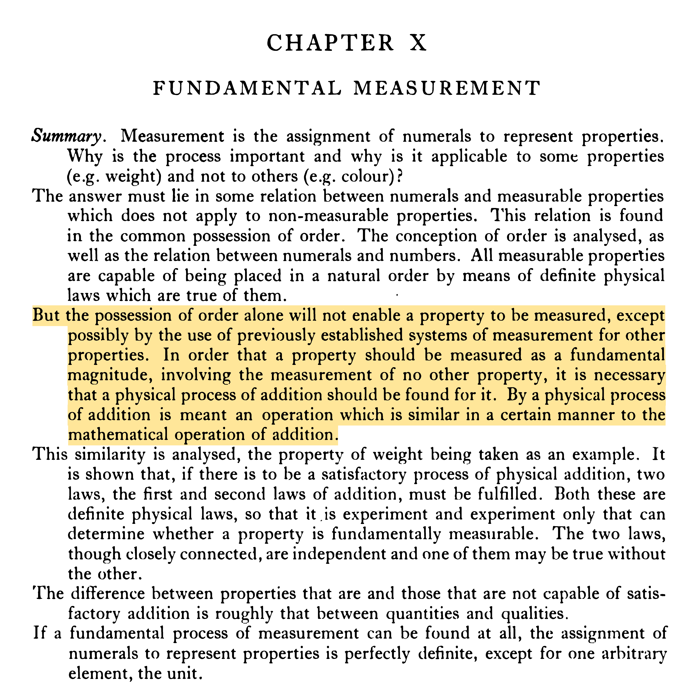

#  {.plain}
\center
\vspace{3mm}
```{r, echo = FALSE, out.width = "20%"}

```

\vspace{4mm}

\Large
\resizebox{\linewidth}{!}{Einführung in die Forschungsmethoden der Psychologie}
\vspace{1mm}

\normalsize
BSc Philosophie-Neurowissenschaften-Künstliche Intelligenz WiSe 2026/27

BSc Psychologie WiSe 2026/27

\large
\vspace{6mm}
Prof. Dr. Dirk Ostwald


#  {.plain}
\vfill
\center
\huge
\textcolor{black}{(5) Repräsentationalismus}
\vfill

#
\vfill
\large
\setstretch{3}
Historische Einordnung 

Repräsentationstheorie

Zusammenfassung und Diskussion

Selbstkontrollfragen 
\vfill

#
\vfill
\large
\setstretch{3}
**Historische Einordnung** 

Repräsentationstheorie

Zusammenfassung und Diskussion

Selbstkontrollfragen 
\vfill

# Historische Einordnung
Psychophysik und die Messbarkeit von Empfindungen 
\vspace{2mm}

\small
@fechner1860 beschreibt eine Methode zur Messung der Intensität einer Empfindung
\vspace{1mm}

"Just noticeable differences" von Empfindungen von Stimuli unterschiedlicher
Intensität

\begin{equation}
\mbox{ Weber-Fechner-Gesetz } p = k \ln\left(\frac{S}{S_0}\right)
\end{equation}

Quantitative Beschreibung der Empfindungsstärke $p$ 
durch den Logarithmus des Verhältnisses von physikalischer Stimulusintensität $S$
und physikalischer Stimulusintensität an der Wahrnehmungsschwelle $S_0$ in Abhängigkeit
von einer wahrnehmungsmodalitätsspezifischen Konstante $k$.

\vspace{2mm}
\flushright
$\Rightarrow$ Aus Sicht der zeitgenössischen Physik handelt es sich dabei nicht um eine "Messung"

# Historische Einordnung
\setstretch{1.6}
Messkonzeption der Physik zwischen 1850 und 1950 

"Fundamental measurement" und "Fundamental magnitudes" 

\small
* Messung von Größen, die sich mit der Größe des betrachteten Systems additiv ändern.
* Beispiele: Masse, Länge, Volumen, Teilchenanzahl, ...
* Physikalische Ordnungsrelation und Additivität als Grundvoraussetzung

\normalsize
"Derived measurement" und "Derived magnitudes"  

\small
* Messung von Größen, die sich mit der Größe des betrachteten Systems nicht (additiv) ändern 
* Beispiele: Temperatur, Dichte, Viskosität, ...
* Rückführung auf Fundamentalmessungen als Grundvoraussetzung 
* Temperatur als Quecksilberausdehnung, Dichte als Volumengewichtsverhältnis, ... 

\flushright vgl. @campbell1920 

# Historische Einordnung
\setstretch{1.6}
Messkonzeption der Physik um 1920 

```{r, echo = FALSE, out.width = "55%", fig.align = "center"}

```
\flushright
\footnotesize
@campbell1920 (vgl. @helmholtz1867, @michell1996 zu Hölder (1901))

# Historische Einordnung

Komitee der British Association for the Advancement of Science von 1932  

```{r, echo = FALSE, out.width = "75%", fig.align = "center"}
knitr::include_graphics("5-Abbildungen/pfm-5-baas-committee.png")
```
\footnotesize
\flushright
@stevens1946 (vgl. @campbell1938)

Seit 2009 [\textcolor{darkblue}{British Science Association}](https://www.britishscienceassociation.org/)

# Historische Einordnung


```{r, echo = FALSE, out.width = "100%", fig.align = "center"}
knitr::include_graphics("5-Abbildungen/pfm-5-stevens-campbell.pdf")
```


# Historische Einordnung
[Position \textcolor{darkblue}{Norman Robert Campbells (1880–1949)}](https://en.wikipedia.org/wiki/Norman_Robert_Campbell) 
\small

* Physiker im Bereich der Elektrizitätsforschung am Hirst Research Center
* Prägung des Begriffs der "Fundamentalmessung" in @campbell1920
* Additivität als Grundvoraussetzung für den Begriff des Messens

\vspace{2mm}
\footnotesize
Aus @stevens1946  One member submitted "that any law purporting to express a 
quantitative relation between sensation in­tensity and stimulus intensity is 
not merely false but is in fact meaningless unless and until a meaning can be 
given to the concept of addition as applied to sen­sation" (Final Report, p. 245).

\vspace{2mm}
Aus @narens1986 Campbell, a mem­ber of the Commission and probably a major force 
in its creation 8 years earlier, wrote, "Why do not psychologists accept the nat­ural 
and obvious conclusion that subjective measurements of loudness in numerical terms 
... are mutually inconsistent and cannot be the basis of measurement?"

\vspace{2mm}
\flushright
\small
$\Rightarrow$ Semioperationalistische Definition des Messbegriffs

$\Rightarrow$ Additivität als Kernvoraussetzung für eine Fundamentalmessung

# Historische Einordnung
[Position \textcolor{darkblue}{Stanley Smith Stevens’ (1906 – 1973)}](https://en.wikipedia.org/wiki/Stanley_Smith_Stevens) 

\small
* Psychophysiker im Bereich auditorische Wahrnehmung am Harvard Psychoacoustic
  Laboratory
* Entwicklung von *Stevens’ power law* als Alternative zum
  Weber-Fechner-Gesetz
* Gründung der [\textcolor{darkblue}{Psychonomic Society}](https://www.psychonomic.org/)

\vspace{2mm}
\footnotesize
Aus @stevens1946 "Paraphrasing N. R. Campbell (Final Report, p. 340), we may say that *measurement*, 
in the broadest sense, *is defined as the assignment of numerals to ob­jects or events 
according to rules*. The fact that numerals can be assigned under *different rules* 
leads to *different kinds of scales* and *different kinds of measurement*. The problem 
then becomes that of making explicit (a) the various rules for the assign­ment of
numerals, (b) the mathematical properties (or group structure) of the resulting scales, 
and (c) the statistical operations applicable to measurements made with each type of scale."

\vspace{2mm}
\flushright
\small
$\Rightarrow$ Operationalistische Definition des Begriffs des Messens

$\Rightarrow$ Fokus auf Skalen und zulässigen Rechenoperationen, Additivität als (nur) eine Möglichkeit


# Historische Einordnung
Klassifikation von Skalen nach Stevens (1946)  

```{r, echo = FALSE, out.width = "100%", fig.align = "center"}
knitr::include_graphics("5-Abbildungen/pfm-5-stevens-scales.pdf")
```
\flushright 
\footnotesize
Aus @stevens1946

# Historische Einordnung
Psychologische Lehrbücher zur Statistik
\vspace{1mm}

\small
Ein *Messvorgang* lässt sich allgemein dadurch charakterisieren, dass einem
Objekt bezüglich der Ausprägung einer Eigenschaft eine Zahl zugeordnet wird. (...)
Erforderlich sind eindeutige Regeln, nach denen diese Zuordnung erfolgt.

\footnotesize
\hfill Bortz und Schuster [-@bortz2010]

\vspace{-1mm}

```{=latex}
\begingroup
\setstretch{1.0}
\fontsize{6}{7.4}\selectfont
\renewcommand{\arraystretch}{1.05}
\setlength{\tabcolsep}{3pt}
\begin{tabularx}{\linewidth}{@{}>{\raggedright\arraybackslash}p{25mm}>{\raggedright\arraybackslash}p{25mm}>{\raggedright\arraybackslash}p{22mm}>{\raggedright\arraybackslash}X@{}}
\toprule
Skalenarten & Zulässige\newline Transformationen & Mögliche Aussagen & Beispiele \\
\midrule
Nominalskala & Eindeutigkeits-\newline transformation & Gleichheit,\newline Verschiedenheit & Automarken,\newline Krankheitsklassifikationen,\newline Familienstand \\
\addlinespace[1.5mm]
Ordinalskala & Monotone\newline Transformation & Größer-Kleiner-\newline Relationen & Militärische Ränge,\newline Windstärken \\
\addlinespace[1.5mm]
Intervallskala & Lineare\newline Transformation & Gleichheit von\newline Differenzen & Temperatur (z.\,B. Celsius),\newline Kalenderzeit,\newline Intensität von Einstellungen \\
\addlinespace[1.5mm]
Verhältnisskala & Ähnlichkeits-\newline transformation & Gleichheit von\newline Verhältnissen & Längenmessung,\newline Gewichtsmessung,\newline Häufigkeiten pro Person \\
\bottomrule
\end{tabularx}
\endgroup
```

\vspace{1mm}
\flushright
(vgl. @doering2023, Kapitel 8.4, Tabelle 8.4)

# Historische Einordnung

\vspace{2mm}
Psychologische per fiat Skalenzuordnung am Beispiel Depressionsdiagnostik

\footnotesize
\vspace{2mm}


```{=latex}
\begingroup
\setstretch{1.0}
\fontsize{6}{7.4}\selectfont
\renewcommand{\arraystretch}{1.12}
\setlength{\tabcolsep}{4pt}
\begin{tabularx}{\linewidth}{@{}>{\raggedright\arraybackslash}p{20mm}>{\raggedright\arraybackslash}p{43mm}>{\raggedright\arraybackslash}X@{}}
\toprule
Skalenart & Beispielitem & Antworten und Codierung \\
\midrule
Nominalskala & Ist eine depressive Episode diagnostiziert? & Nein (0), Ja (1) \\
\addlinespace[1.5mm]
 & Welche Beschwerde steht im Vordergrund? & Niedergeschlagenheit (1),\newline Interessenverlust (2), Antriebsmangel (3) \\
\midrule
Ordinalskala & Wie stark sind Ihre Beschwerden? & Leicht (1), mittel (2), stark (3) \\
\addlinespace[1.5mm]
 & Wie häufig fühlen Sie\newline sich niedergeschlagen? & Selten (1), gelegentlich (2), häufig (3) \\
\midrule
Intervallskala & Wie niedergeschlagen fühlen Sie sich heute? & Skala von 0 bis 10:\newline gar nicht (0) bis äußerst (10) \\
\addlinespace[1.5mm]
 & Wie groß ist Ihr Interesse\newline an alltäglichen Aktivitäten? & Skala von 0 bis 10:\newline kein Interesse (0) bis\newline sehr großes Interesse (10) \\
\midrule
Verhältnisskala & Wie viele depressive Episoden\newline wurden bisher diagnostiziert? & Anzahl: 0, 1, 2, 3, \ldots \\
\addlinespace[1.5mm]
 & An wie vielen Tagen der letzten zwei Wochen fühlten Sie sich niedergeschlagen? & Anzahl der Tage: 0, 1, 2, \ldots, 14 \\
\bottomrule
\end{tabularx}
\endgroup
```

\vspace{1mm}
\flushright
(vgl. @doering2023)


# Historische Einordnung
Psychologische Lehrbücher zur Statistik 

\setstretch{2.7}

Der Begriff **Skala** wird mindestens in drei unterschiedlichen Bedeutungen genutzt

* Im Sinne der Skalenarten nach @stevens1946, z.B. Intervallskala
* Im Sinne einer Messskala, z.B. Rating-Skala nach @likert1932 
* Im Sinne eines Fragebogens, z.B. Basic Empathy Scale


\flushright
Auch wenn der Begriff identisch ist, haben diese Dinge nichts miteinander zu tun!

Für eine Einführung, vgl. @norman2010.


#
\vfill
\large
\setstretch{3}
Historische Einordnung

**Repräsentationstheorie**

Zusammenfassung und Diskussion

Selbstkontrollfragen 
\vfill  

# Repräsentationstheorie
\setstretch{1.6}

\large
Repräsentationstheorie 
\normalsize

Begründet um 1950 durch [\textcolor{darkblue}{Patrick Suppes}](https://en.wikipedia.org/wiki/Patrick_Suppes) 

* Klärung des Begriffs des Messens über den Stand der Physik von 1950 hinaus
* Ausarbeitung und Differenzierung der Stevensschen Skalenklassifikation
* Nachweis der Fundamentalmessung ohne empirische Additivität 

$\Rightarrow$ Anwendung des Programms des Logischen Positivismus mit Hochphase 1950 - 2000 

Zentrale Arbeiten 

* @scott1958 als Startpunkt
* @luce1964 als zentraler Beitrag  
* @krantz1971, @suppes1989, @luce1990 als Gesamtwerk

Für ein einführendes vertieftes Verständnis wird @roberts1984 empfohlen.

# Repräsentationstheorie
Grundmodell der Repräsentationstheorie 


```{r, echo = FALSE, out.width = "80%", fig.align = "center"}
knitr::include_graphics("5-Abbildungen/pfm-5-rtm.pdf")
```

\small
Mathematische Theorie aus Axiomen/Definitionen, Theoremen und Beweisen

Mengen und spezielle Mengen (Relationen, Operationen, Abbildungen) als Gegenstände

# Repräsentationstheorie
Relationen und Operationen 

\small
Relationen
\vspace{-1mm}
\footnotesize

* Binäre Relationen sind Beziehungen zwischen zwei Dingen.
* Im qualitativen Relationssystem betrachtet die RT qualitative Relationen von empirischen Eigenschaften.
* Beispiele für qualitative Relationen sind "nicht wahrnehmbar kürzer als" oder "wärmer als".
* Qualitative Relationen werden oft mit $\succ$, $\prec$ oder $\diamond$ bezeichnet.
* Im quantitativen Relationssystem betrachtet die RT quantitative Relationen von Zahlen.
* Beispiele für quantitative Relationen sind $>$, $=$ und $<$.
* Formal sind binäre Relationen auf $M$ Teilmengen von $M \times M$.
  Vierstellige Relationen, etwa Differenzvergleiche, sind Teilmengen von $M^4$.

\small
Operationen
\vspace{-1mm}
\footnotesize

* Operationen sind Verknüpfungen zwischen zwei Dingen (Objekten, Objekteigenschaften, Zahlen).
* Operationen verknüpfen zwei Dinge zu einem resultierenden dritten Ding.
* Im qualitativen Relationssystem betrachtet die RT empirische Konkatenationen als Operationen.
* Ein Beispiel für eine qualitative Operation ist das Hintereinanderlegen zweier
  Stäbe.
* Qualitative Operationen werden oft mit $\circ$ bezeichnet.
* Im quantitativen Relationssystem betrachtet die RT mathematische Verknüpfungen
  als Operationen.
* Ein Beispiel für eine quantitative Operation ist die Addition zweier reeller
  Zahlen.
* Quantitative Operationen werden mit den Standardsymbolen +, -, $\cdot$, / bezeichnet.

# Repräsentationstheorie
Qualitatives und quantitatives Relationssystem 

\small
Qualitatives Relationssystem
\footnotesize

* Einheit $(M,\succ,\circ)$ aus Objekteigenschaftsmenge $M$, qualitativer Relation $\succ$ und qualitativer Operation $\circ$.
* Das qualitative Relationssystem wird in der Repräsentationstheorie als bekannt
  vorausgesetzt.
* Die qualitativen empirischen Eigenschaften von Dingen sind also nach Voraussetzung bekannt.
* Je nach Art des qualitativen Relationssystems haben Relationen und Operationen verschiedene Eigenschaften.
* Ein Beispiel für eine Relationseigenschaft ist die *Transitivität*
\begin{equation}
\mbox{ Wenn } m \succ n \mbox{ und } n \succ p \mbox{, dann gilt } m \succ p \mbox{ für alle } m,n,p \in M.
\end{equation}
* Ein Beispiel für eine Operationseigenschaft ist die *Assoziativität*
\begin{equation}
(m \circ n) \circ p = m \circ (n \circ p).
\end{equation}

\small
Quantitatives Relationssystem
\footnotesize

* Einheit $(\mathbb{R},>,+)$ aus Zahlen $\mathbb{R}$, quantitativer Relation $>$ und quantitativer Operation $+$.
* Das quantitative Relationssystem entspricht meist den vertrauten Zahlräumen und
  Zahlenoperationen.
* Je nach Art des quantitativen Relationssystems haben Relationen und Operationen verschiedene Eigenschaften.
* In $(\mathbb{R},>,+)$ gelten zum Beispiel auch die *Transitivität* und *Assoziativität*, denn
\begin{equation}
x > y \mbox{ und } y > z \Rightarrow x > z \mbox{ und }
(x + y) + z = x + (y + z) \mbox{ für alle } x,y,z \in \mathbb{R}.
\end{equation}

# Repräsentationstheorie
Homomorphismen und Skalen 

\small
Homomorphismen
\footnotesize

* Homomorphismen sind "strukturerhaltende" Abbildungen zwischen den Relationssystemen.
* Eine Abbildung $f: M \to \mathbb{R}$ heißt im obigen Beispiel strukturerhaltend,
  wenn gilt:
\begin{equation}
m \succ n \Leftrightarrow f(m) > f(n)
\mbox{ und }
f(m \circ n) = f(m) + f(n)
\mbox{ für alle } m,n\in M.
\end{equation}
* $\Rightarrow$ Die Funktionswerte von $m$ und $n$ in $\mathbb{R}$ stehen
  "in der gleichen Relation" wie $m$ und $n$ in $M$.
* $>$ im quantitativen Relationssystem spiegelt dann $\succ$ im qualitativen
  Relationssystem.
* $\Rightarrow$ Der Funktionswert der Verknüpfung von $m$ und $n$ gleicht der Verknüpfung der Funktionswerte von $m$,$n$. 
* $+$ im quantitativen Relationssystem spiegelt dann $\circ$ im qualitativen Relationssystem.
* Die Betrachtung von $(M,\succ,\circ)$ und $(\mathbb{R},>, +)$ ist allerdings nur ein Beispiel.
* $\Rightarrow$ In der Repräsentationstheorie ist man an Spiegelungen beliebiger Relationen und Operationen interessiert.

\small
Skalen
\footnotesize

* Die Einheit $(\mathcal{M}, \mathcal{N},f)$ aus einem qualitativen Relationssystem $\mathcal{M}$, einem quantitativen Relationssystem 
$\mathcal{N}$ und einem Homomorphismus $f$ zwischen ihnen wird in der Repräsentationstheorie als *Skala* bezeichnet. 
* Der Skalenbegriff der Repräsentationstheorie erweitert und schärft den Skalenbegriff nach @stevens1946.
* Der Skalenbegriff der Repräsentationstheorie hat mit dem Wort "Skala" für einen Fragebogen wenig zu tun.

# Repräsentationstheorie
Repräsentationsproblem und Eindeutigkeitsproblem 

\small
Repräsentationsproblem
\footnotesize

* Die Analyse von notwendigen und hinreichenden Bedingungen für die Existenz eines Homomorphismus 
zwischen den Relationssystemen wird Repräsentationsproblem genannt.
* Notwendige Bedingungen sind Eigenschaften der Relationssysteme, wenn ein Homomorphismus existiert. 
* Hinreichende Bedingungen sind Eigenschaften der Relationssysteme zur Konstruktion eines Homomorphismus.
* Theoreme, die besagen, dass bestimmte Eigenschaften des qualitativen Relationssystems 
für die Existenz eines Homomorphismus notwendig und hinreichend sind, werden *Repräsentationstheoreme* genannt.
* Wenn ein Homomorphismus existiert, dann ist im Sinne der Repräsentationstheorie eine "Messung" möglich.

\small
Eindeutigkeitsproblem
\footnotesize

* Das Eindeutigkeitsproblem der Repräsentationstheorie besteht darin, zu bestimmen, 
  ob ein existierender Homomorphismus der einzige mögliche ist.
* Die Antworten auf Eindeutigkeitsprobleme legen die Skalenarten fest, insbesondere 
sind die Homomorphismen dort nicht eindeutig, sondern durch sogenannte *zulässige Transformationen* ineinander überführbar. 
* Eine Abbildung $\phi$ heißt *zulässige Transformation*, wenn gilt, dass bei gegebenen Relationssystemen 
wenn $f$ ein Homomorphismus ist, $\phi \circ f$ auch ein Homomorphismus ist. 

# Repräsentationstheorie

Skalenarten 
\footnotesize

Gegeben sei eine Skala $(\mathcal{M},\mathcal{N},f)$ mit zugrundeliegenden Mengen 
$M$ und $\mathbb{R}$ und Homomorphismus $f$. Weiterhin sei 
\begin{equation}
\Phi := \{\phi \mid \phi : f(M) \to \mathbb{R},\ \phi \circ f \in \mathcal{H}(\mathcal{M},\mathcal{N})\}
\end{equation}
die Menge der zulässigen Transformationen von $(\mathcal{M},\mathcal{N},f)$.
Dabei ist $\mathcal{H}(\mathcal{M},\mathcal{N})$ die Menge aller Homomorphismen
von $\mathcal{M}$ nach $\mathcal{N}$. Dann ist die
*Skalenart* von $(\mathcal{M},\mathcal{N},f)$ durch $\Phi$ bestimmt. Insbesondere gelten: 

(1) Wenn die Menge der zulässigen Transformationen der Skala die Menge der
*streng monoton steigenden Funktionen*
\begin{equation}
\Phi := \{\phi| \phi : f(M) \to \mathbb{R}, x \mapsto \phi(x)  \mbox{ mit } x > y \Leftrightarrow \phi(x) > \phi(y) \mbox{ für alle } x,y \in f(M)\}
\end{equation}
ist, dann heißt $(\mathcal{M},\mathcal{N},f)$ *Ordinalskala*.
(2) Wenn die Menge der zulässigen Transformationen der Skala  die Menge der *positiv linear-affinen Funktionen*
\begin{equation}
\Phi := \{\phi| \phi : f(M) \to \mathbb{R}, x \mapsto \phi(x) := \alpha x + \beta  \mbox{ mit } \alpha > 0\}
\end{equation}
ist, dann heißt $(\mathcal{M},\mathcal{N},f)$ *Intervallskala*.
(3) Wenn die Menge der zulässigen Transformationen der Skala die Menge der *Ähnlichkeitstransformationen*
\begin{equation}
\Phi := \{\phi| \phi : f(M) \to \mathbb{R}, x \mapsto \phi(x) := \alpha x \mbox{ mit } \alpha > 0\}
\end{equation}
ist, dann heißt $(\mathcal{M},\mathcal{N},f)$ *Verhältnisskala*.


# Repräsentationstheorie
\setstretch{1.2}
\vspace{2mm}
\small
Beispiel: Ordinalmessung 

\footnotesize
*Definition (Strenge schwache Ordnung)*

$M$ sei eine Menge und $R$ sei eine Binärrelation auf $M$. $R$ heißt 
\textit{strenge schwache Ordnung} auf $M$, wenn $R$ asymmetrisch und negativ transitiv ist.
Eine Binärrelation $R$ auf einer Menge $M$ heißt \textit{asymmetrisch}, wenn für alle 
$(m,n) \in R$ gilt, dass $(n,m) \notin R$ ist. Eine Binärrelation $R$ auf einer 
Menge $M$ heißt \textit{negativ transitiv}, wenn für alle $m,n,p\in M$ gilt, dass 
aus $(m,n) \notin R$ und $(n,p)\notin R$ folgt, dass $(m,p) \notin R$ ist.

*Theorem (Repräsentation strenger schwacher Ordnungen)*

$\mathcal{M} := (M,\succ)$ sei ein qualitatives Relationssystem mit einer endlichen Menge
$M$ und einer Binärrelation $\succ$ auf $M$ und $\mathcal{N} := (\mathbb{R},>)$ sei
ein quantitatives Relationssystem. Dann existiert ein Homomorphismus $f$ von
$\mathcal{M}$ nach $\mathcal{N}$, also eine Funktion der Form
\begin{equation}
f : M \to \mathbb{R}, m \mapsto f(m)
\mbox{ mit der Eigenschaft }
m \succ n  \Leftrightarrow f(m) > f(n)
\end{equation}
dann und nur dann, wenn $\succ$ eine strenge schwache Ordnung ist.

*Theorem (Eindeutigkeit der Repräsentation strenger schwacher Ordnungen)*

$\mathcal{M} := (M,R)$ sei ein qualitatives Relationssystem aus einer endlichen Menge
$M$ und einer strengen schwachen Ordnung $R$ auf $M$, $\mathcal{N} := (\mathbb{R},>)$ sei
ein quantitatives Relationssystem und es sei $f \in \mathcal{H}(\mathcal{M},\mathcal{N})$.
Dann ist $(\mathcal{M},\mathcal{N},f)$ eine Ordinalskala,  die Klasse der zulässigen 
Transformationen von $f$ sind also die streng monoton steigenden Funktionen.

Bemerkungen 
\vspace{-2mm}

* Für Beweise des Repräsentationstheorems und des Eindeutigkeitstheorems verweisen wir auf @roberts1984.
* Für einen Einstieg verweisen wir auf [\textcolor{darkblue}{Psychologische Forschungsmethoden 2023}](https://youtu.be/NxjfVFdYa-k?si=6_fdLLlfNJWvx_P_).


# Repräsentationstheorie
Bedeutsamkeit 
\footnotesize

* Eine Statistik heißt im Sinne der Repräsentationstheorie *bedeutsam*, wenn
für ihren Wert irrelevant ist, ob eine Skalentransformation auf der Ebene 
der Werte des Homomorphismus oder auf der Ebene der Werte der Statistik durchgeführt wird.

* Formaler gilt folgende Definition: $(\mathcal{M},\mathcal{N},f)$ sei eine Skala
mit Objektmenge $M$. Die Transformationen $\phi:I\to\mathbb{R}$ seien auf einem
Bereich $I\subseteq\mathbb{R}$ definiert, der $f(M)$ und die betrachteten
Statistikwerte enthält. Die Transformationsvorschriften des jeweiligen
Skalentyps gelten auf ganz $I$, die Einschränkungen auf $f(M)$ seien zulässig.
Die *reellwertige Statistik* $\gamma$ sei auf ganz $\mathbb{R}^n$ definiert:
\begin{equation}
\gamma : \mathbb{R}^n \to \mathbb{R}, (x_1,...,x_n) \mapsto \gamma(x_1,...,x_n).
\end{equation}
Dann wird $\gamma$ eine *bedeutsame Statistik* genannt, wenn für alle solchen
zulässigen Transformationen $\phi$ und für alle $m_1,...,m_n\in M$ gilt:
\begin{equation}
\phi\left(\gamma\left(f(m_1),...,f(m_n)\right) \right) = \gamma\left(\phi(f(m_1)),...,\phi(f(m_n))\right)
\end{equation}

* Im Folgenden zeigen wir, dass zum Beispiel der Mittelwert 
\begin{equation}
\gamma : \mathbb{R}^n \to \mathbb{R}, (x_1,...,x_n) \mapsto \gamma(x_1,...,x_n) := \frac{1}{n}\sum_{i=1}^n x_i
\end{equation}
im Allgemeinen keine bedeutsame Statistik ist, wenn $f$ eine Ordinalskala ist, aber 
eine bedeutsame Statistik, wenn $f$ eine Intervall- oder Verhältnisskala ist.

# Repräsentationstheorie
Bedeutsamkeit 
\footnotesize

*Beweis der Nicht-Bedeutsamkeit des Mittelwerts bei Ordinalskala*

Es sei $(\mathcal{M}, \mathcal{N},f)$ eine Ordinalskala und $\phi$ eine 
zulässige Transformation von $f$, also eine streng monoton steigende Funktion. Für 
$f(M) \subset \mathbb{R}_{>0}$ und $n := 2$ seien $f(m_1) = 1$ und $f(m_2) = 3$
und es sei $\phi$ die streng monoton steigende Funktion
\begin{equation}
\phi : \mathbb{R}_{>0} \to \mathbb{R}_{>0}, x \mapsto \phi(x) := x^2.
\end{equation}
Dann gilt
\begin{equation}
\phi(\gamma(f(m_1),f(m_2)))
= \phi\left(\frac{1}{2}(1+3)\right)
= \phi(2)
= 2^2
= 4.
\end{equation}
Es gilt aber auch
\begin{equation}
\gamma(\phi(f(m_1)),\phi(f(m_2)))
= \gamma(\phi(1),\phi(3))
= \gamma\left(1^2,3^2\right)
= \frac{1}{2}(1 + 9)
= 5.
\end{equation}
Also gilt
\begin{equation}
\phi(\gamma(f(m_1),f(m_2))) = 4 \neq 5 = \gamma(\phi(f(m_1)),\phi(f(m_2))).
\end{equation}

# Repräsentationstheorie
\vspace{2mm}
Bedeutsamkeit 
\footnotesize

*Beweis der Bedeutsamkeit des Mittelwerts bei Intervallskala*

Es sei $(\mathcal{M}, \mathcal{N},f)$ eine Intervallskala und $\phi$ eine 
zulässige Transformation von $f$, also eine Funktion der Form
\begin{equation}
\phi : \mathbb{R} \to \mathbb{R}, x \mapsto \phi(x) := \alpha x + \beta \mbox{ mit } \alpha > 0
\end{equation}
Dann gilt
\begin{align*}
\begin{split}
\phi(\gamma(f(m_1),..., f(m_n)))
&  = \phi\left(\frac{1}{n}\sum_{i=1}^n f(m_i)\right)                             \\
& = \alpha\left(\frac{1}{n}\sum_{i=1}^n f(m_i)\right) +  \beta                   \\
& = \frac{1}{n}\sum_{i=1}^n \alpha f(m_i) + \frac{1}{n}\sum_{i=1}^n\beta         \\
& = \frac{1}{n}\left(\sum_{i=1}^n \alpha f(m_i) + \sum_{i=1}^n \beta \right)     \\
& = \frac{1}{n}\sum_{i=1}^n (\alpha f(m_i) + \beta)                              \\
& = \frac{1}{n}\sum_{i=1}^n \phi(f(m_i))                                         \\   
&  = \gamma(\phi(f(m_1)), ...,\phi(f(m_n))).                   
\end{split}
\end{align*}
 
# Repräsentationstheorie
Bedeutsamkeit 

\footnotesize
*Beweis der Bedeutsamkeit des Mittelwertes bei Verhältnisskala*

Es sei $(\mathcal{M}, \mathcal{N},f)$  eine Verhältnisskala und $\phi$ eine 
zulässige Transformation von $f$, also eine Ähnlichkeitstransformation der Form
\begin{equation}
\phi : \mathbb{R} \to \mathbb{R}, x \mapsto \phi(x) := \alpha x \mbox{ mit } \alpha > 0
\end{equation}
Dann gilt
\begin{align}
\begin{split}
\phi(\gamma(f(m_1),..., f(m_n)))
& = \phi\left(\frac{1}{n}\sum_{i=1}^n f(m_i)\right)         \\
& = \alpha\frac{1}{n}\sum_{i=1}^n f(m_i)                    \\
& = \frac{1}{n} \sum_{i=1}^n \alpha f(m_i)                  \\
& = \frac{1}{n} \sum_{i=1}^n \phi(f(m_i))                   \\
& = \gamma(\phi(f(m_1)), ...,\phi(f(m_n))).                  \\
\end{split}
\end{align}
 

#
\vfill
\large
\setstretch{3}
Historische Einordnung

Repräsentationstheorie

**Zusammenfassung und Diskussion**

Selbstkontrollfragen 
\vfill

# Zusammenfassung und Diskussion
\vspace{2mm}
Der Skalenbegriff der Repräsentationstheorie des Messens 
```{r, echo = FALSE, out.width = "80%", fig.align = "center"}
knitr::include_graphics("5-Abbildungen/pfm-5-skalen-rtm.pdf")
```


# Zusammenfassung und Diskussion
\vspace{2mm}
Der Per-fiat-Skalenbegriff der Psychologie 
```{r, echo = FALSE, out.width = "80%", fig.align = "center"}
knitr::include_graphics("5-Abbildungen/pfm-5-skalen-psy.pdf")
```


# Zusammenfassung und Diskussion
Repräsentationstheorie und Realismus 

```{r, echo = FALSE, out.width = "100%", fig.align = "center"}
knitr::include_graphics("5-Abbildungen/pfm-5-rtm-realismus.pdf")
```

\footnotesize

Die Repräsentationstheorie setzt die Existenz des qualitativen Relationssystems voraus.

Die Repräsentationstheorie macht keine Aussage darüber, wie sich das qualitative Relationssystem ergibt. 

Die Repräsentationstheorie hat kein Konzept eines wahren Wertes.


# Zusammenfassung und Diskussion
Repräsentationstheorie und Messfehler 

\small
Die Repräsentationstheorie geht von idealisierten qualitativen Relationssystemen aus.

Die Repräsentationstheorie verzichtet auf metaphysische Aussagen hinsichtlich
wahrer Werte, allerdings idealisiert sie qualitative Daten als "messfehlerfrei".
Eine einzige Beobachtung, die nicht mit den Eigenschaften des qualitativen
Relationssystems übereinstimmt, invalidiert das Anwendungspotential der
Repräsentationstheorie.

Es fehlt ein "Messfehlerkonzept" in der empirischen Bestimmung des qualitativen
Relationssystems.

Versuche in diese Richtung führen auf probabilistische Modelle (vgl. @falmagne1980, @rossi2006).

$\Rightarrow$ Die Repräsentationstheorie wird zur praktischen Entwicklung von Skalen nicht angewandt.

$\Rightarrow$ Im Bereich der Test- und Fragebogenentwicklung herrscht das Konzept der *Validität* vor.


# Zusammenfassung und Diskussion
Repräsentationstheorie und Datenanalyse 
\small

Der *Bedeutsamkeitsbegriff* ist bedingt auf der Validität der Repräsentationstheorie.

Da Validität der Repräsentationstheorie in Anwendungsfällen nicht nachgewiesen wird, 
wird der Bedeutsamkeitsbegriff in der Datenanalyse ignoriert und seit @lord1953 kritisiert.

Der präskriptive Charakter der Repräsentationstheorie hat zu wiederholten
Kontroversen zwischen Messtheoretikern und Datenanalysten geführt (vgl. @lord1953,
@gaito1980, @townsend1984, @michell1986, @velleman1993, @cliff1992), jedoch ohne eine
konstruktive Konklusion oder praktische Relevanz.
@borsboom2009 schreibt dazu:

\footnotesize
 "The scale type is often deemed very important for determining what kind of statistics 
may be used, and in this manner it exerts considerable influence on the practice of 
data analysis in psychology (or, in any event, on the conscience of psychologists 
doing the analyses). The prescriptive aspect of scales has been the subject of 
enduring controversies between measurement theoreticians and statisticians (...), 
mainly because statisticians refuse to be told what is admissible and what not by 
what they seem to perceive as an utterly impractical theory. However, apart from 
generating such controversies and acting on the psychologist’s statistical 
conscience, scales and the associated theory of measurement have not entered 
mainstream psychology at all (Cliff, 1992)."


# Zusammenfassung und Diskussion
Repräsentationstheorie als Operationalismus 
\vspace{2mm}

\small
Repräsentationstheorie als "operationalistische rationale Rekonstruktion" des Messens.

$\Rightarrow$ Anwendung des Programms des Logischen Positivismus $\checkmark$

$\Rightarrow$ Klare Formulierung, Einordnung und Ausarbeitung der Stevensschen
Skalenklassifikation $\checkmark$

$\Rightarrow$ Nachweis der Fundamentalmessung ohne empirische Additivität  $\checkmark$

\vspace{4mm}

Die Repräsentationstheorie rechtfertigt die epistemische und soziale Autorität des
Messens nicht.

$\Rightarrow$ Axiome der Repräsentationstheorie werden in der Anwendung nicht überprüft. 

$\Rightarrow$ Die Repräsentationstheorie spielt in der psychologischen Anwendung keine Rolle. 

$\Rightarrow$ Die Wissenschaftlichkeit psychologischer Tests wird mithilfe der Validitätstheorie gerechtfertigt.


#
\vfill
\large
\setstretch{3}
Historische Einordnung 

Repräsentationstheorie

Zusammenfassung und Diskussion

**Selbstkontrollfragen** 
\vfill

# Selbstkontrollfragen 
\footnotesize
\setstretch{3}
1. Skizzieren Sie die Positionen Norman Robert Campbells und Stanley Smith Stevens’
   zum Begriff der Messung.
1. Nennen und erläutern Sie die vier Skalenarten wie in psychologischen Lehrbüchern dargestellt.
1. Erläutern Sie die Begriffe der Relationen und Operationen im Kontext der Repräsentationstheorie.
1. Erläutern Sie die Begriffe des qualitativen und des quantitativen Relationssystems der Repräsentationstheorie.
1. Erläutern Sie den Begriff des Homomorphismus der Repräsentationstheorie.
1. Erläutern Sie den Begriff der Skala im Kontext der Repräsentationstheorie.
1. Erläutern Sie den Begriff der Bedeutsamkeit einer Statistik im Sinne der Repräsentationstheorie.
1. Erläutern Sie die Begriffe des Repräsentations- und des Eindeutigkeitsproblems der Repräsentationstheorie. 


# Referenzen {.allowframebreaks}
\setstretch{1.2}
\footnotesize  

